# AI 工具輿情分析 / 風險警報器系統報告

期末專案 PDF 報告

    > 本報告依據專案程式碼、Django templates、static、資料庫與實際頁面截圖整理。  

    ## 1. 專案簡介

    本專案是一個以 Django 建置的 AI 工具輿情觀測與風險警報系統，主要針對 ChatGPT、Gemini、Claude 三種 AI 工具，從科技新聞資料中整理新聞聲量、情緒、熱門關鍵字、代表新聞、AI 生成報告、新聞懶人包、風險判斷與爆紅原因分析。

    使用者可以透過網頁操作：

    - 查看目前新聞資料庫概況與更新狀態。
    - 查詢 AI 工具新聞資料。
    - 分析熱門關鍵字、每日聲量趨勢、工具之間的情緒與聲量差異。
    - 依任務情境推薦適合的 AI 工具。
    - 使用 Ollama 產生 AI 分析報告或新聞懶人包。
    - 透過風險警報器觀察隱私、版權、安全、監管、營運與技術等風險。
    - 透過 RAG 與 Ollama 分析某段時間內 AI 工具爆紅的可能原因。

    系統主要解決的問題是：AI 工具相關新聞量大且分散，人工逐篇閱讀不容易快速掌握趨勢、風險與討論焦點。本系統將新聞蒐集、分類、統計、視覺化、AI 摘要與風險判斷整合在同一平台中，適合作為課堂專題或輿情監測雛形。

    ## 2. 系統架構

    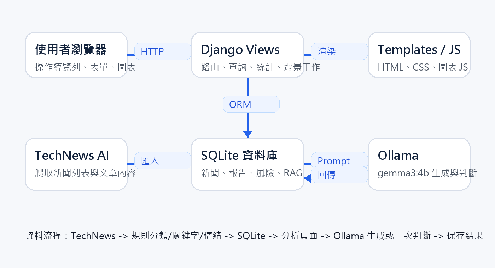

    | 類別 | 專案中使用內容 |
    |---|---|
    | 後端框架 | Django 5.2 |
    | 前端技術 | Django Templates、HTML、CSS、Chart.js、WordCloud2.js |
    | 資料庫 | SQLite，資料庫檔案為 `db.sqlite3` |
    | 爬蟲 / 資料來源 | `requests`、BeautifulSoup，來源為 TechNews AI 分類頁 |
    | 資料處理 | Python Counter、Django ORM aggregation、規則式工具分類、情緒判斷、關鍵字擷取 |
    | AI / NLP | Ollama HTTP API：`http://localhost:11434/api/generate` |
    | Ollama 模型 | `gemma3:4b` |
    | 管理後台 | Django Admin，自訂 `templates/admin/base_site.html` 與 `static/admin/css/custom_admin.css` |
    | README / pyproject | 專案中未明確定義 README.md 或 pyproject.toml；有 `requirements.txt` |

    ### 主要資料表

    | 模型 | 用途 |
    |---|---|
    | `NewsArticle` | 儲存新聞標題、日期、來源、內容、工具分類、情緒、關鍵字、連結 |
    | `DataUpdateLog` | 記錄新聞更新狀態與訊息 |
    | `AnalysisReport` | 儲存 AI 自動生成分析報告 |
    | `DigestReport` | 儲存 AI 新聞懶人包 |
    | `RiskAnalysisResult` | 儲存整體風險分析快照 |
    | `RiskArticleJudgement` | 儲存單篇新聞的風險二次判斷結果 |
    | `HotEvent` | 儲存爆紅事件與原因 |
    | `HotEventRAGQuery` | 儲存 RAG 問答紀錄 |

    ### 目前資料庫狀態

    | 指標 | 數值 |
    |---|---:|
    | 新聞總筆數 | 949 |
    | ChatGPT 新聞 | 54 |
    | Gemini 新聞 | 15 |
    | Claude 新聞 | 55 |
    | Other 新聞 | 825 |
    | 正面 / 中性 / 負面 | 724 / 132 / 93 |
    | AI 分析報告紀錄 | 2 |
    | AI 懶人包紀錄 | 3 |
    | 風險分析快照 | 76 |
    | 單篇風險判斷 | 59，其中 Ollama 26、fallback 33 |
    | 爆紅事件 | 49 |
    | RAG 查詢紀錄 | 2 |
    | 最近更新紀錄 | 2026-06-24 12:03:24，success，抓取 536 筆，新增 68 筆，更新 4 筆，未變更 464 筆 |

    ## 3. 頁面功能介紹

### 首頁 (/)

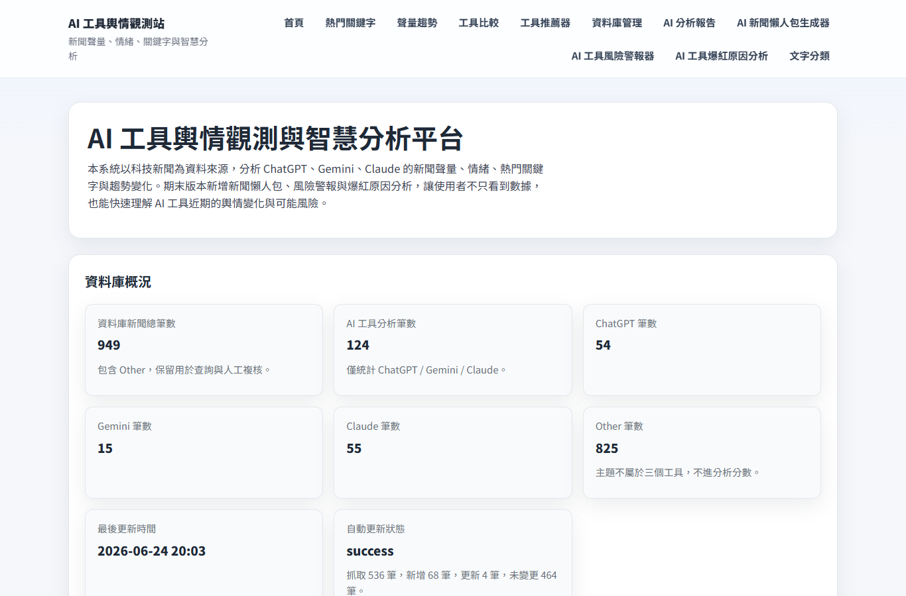

| 項目 | 說明 |
|---|---|
| 頁面功能 | 顯示系統名稱、專案說明、新聞資料庫總筆數、三大 AI 工具筆數、Other 筆數與最新資料更新狀態。進入首頁時會檢查今日是否需要更新 TechNews AI 新聞，必要時以背景執行緒啟動更新。 |
| 使用者操作流程 | 使用者進入首頁 -> 查看資料庫概況 -> 由導覽列進入各分析功能。 |
| 使用到的技術 | Django view、Django template、SQLite ORM、背景 thread、共用 base.html CSS。 |
| 是否使用資料庫 | 有，讀取 NewsArticle 與 DataUpdateLog。 |
| 是否使用 AI 模型或關鍵字判斷 | 首頁本身沒有呼叫 AI；新聞更新流程會使用規則分類工具、情緒與關鍵字。 |

### 熱門關鍵字分析 (/topword/)

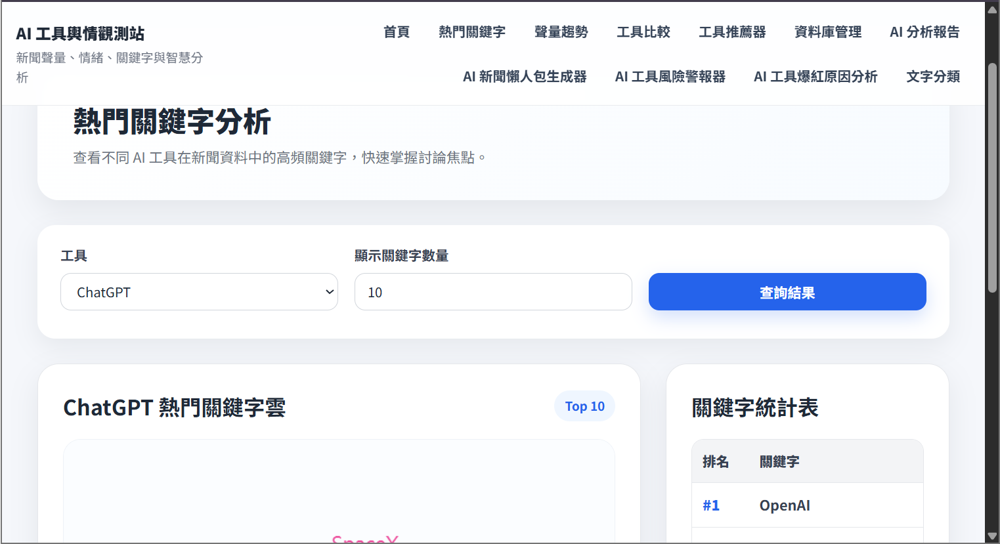

| 項目 | 說明 |
|---|---|
| 頁面功能 | 依工具與 Top N 條件統計新聞 keywords 欄位，顯示關鍵字雲與關鍵字排名表。 |
| 使用者操作流程 | 選擇 ALL/ChatGPT/Gemini/Claude -> 輸入顯示數量 -> 送出查詢 -> 查看文字雲與統計表。 |
| 使用到的技術 | Django ORM、Counter、WordCloud2.js、HTML canvas。 |
| 是否使用資料庫 | 有，讀取 NewsArticle.keywords。 |
| 是否使用 AI 模型或關鍵字判斷 | 沒有呼叫 AI；使用已存在的關鍵字欄位做規則統計。 |

### 聲量趨勢分析 (/trend/)

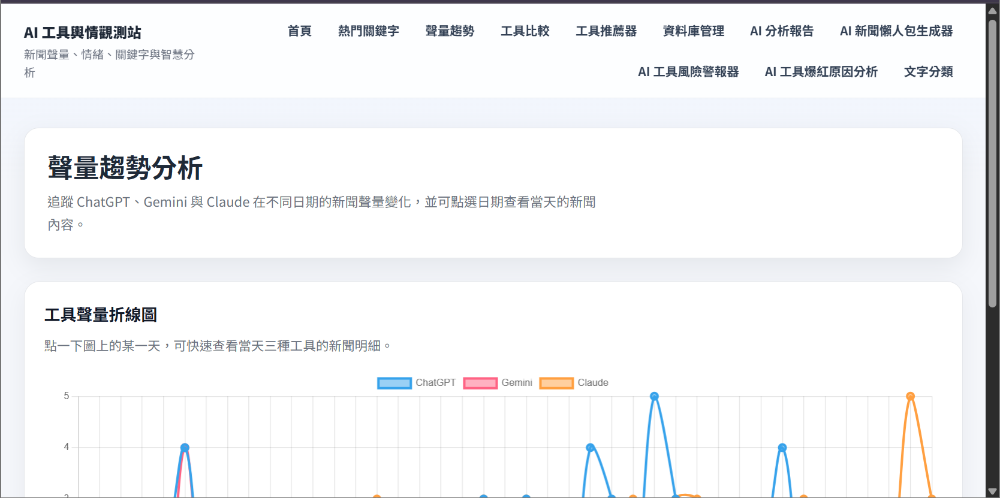

| 項目 | 說明 |
|---|---|
| 頁面功能 | 依日期與工具分組統計新聞聲量，使用折線圖呈現 ChatGPT、Gemini、Claude 的每日討論量。點擊圖表日期後可查看該日新聞明細。 |
| 使用者操作流程 | 進入頁面 -> 查看折線圖 -> 點擊某日期 -> 展開該日期各工具新聞列表 -> 可開啟原文。 |
| 使用到的技術 | Django ORM group by、Chart.js line chart、GET date 篩選。 |
| 是否使用資料庫 | 有，讀取 NewsArticle。 |
| 是否使用 AI 模型或關鍵字判斷 | 沒有呼叫 AI；屬於資料統計與圖表視覺化。 |

### 工具比較 (/compare/)

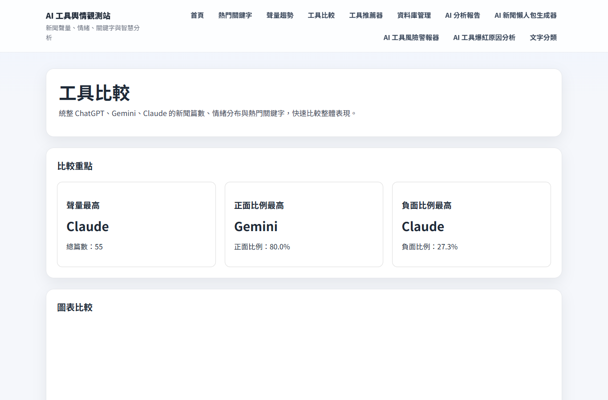

| 項目 | 說明 |
|---|---|
| 頁面功能 | 比較三大工具的新聞量、正中負情緒數量、正面率、負面率與熱門關鍵字 Top 5。 |
| 使用者操作流程 | 進入頁面 -> 查看比較重點卡片 -> 查看新聞量與情緒圖表 -> 查看比較總覽表。 |
| 使用到的技術 | Django ORM、Counter、Chart.js bar chart。 |
| 是否使用資料庫 | 有，讀取 NewsArticle。 |
| 是否使用 AI 模型或關鍵字判斷 | 沒有即時呼叫 AI；使用資料庫中已分類的 sentiment 與 keywords。 |

### AI 工具推薦器 (/recommend/)

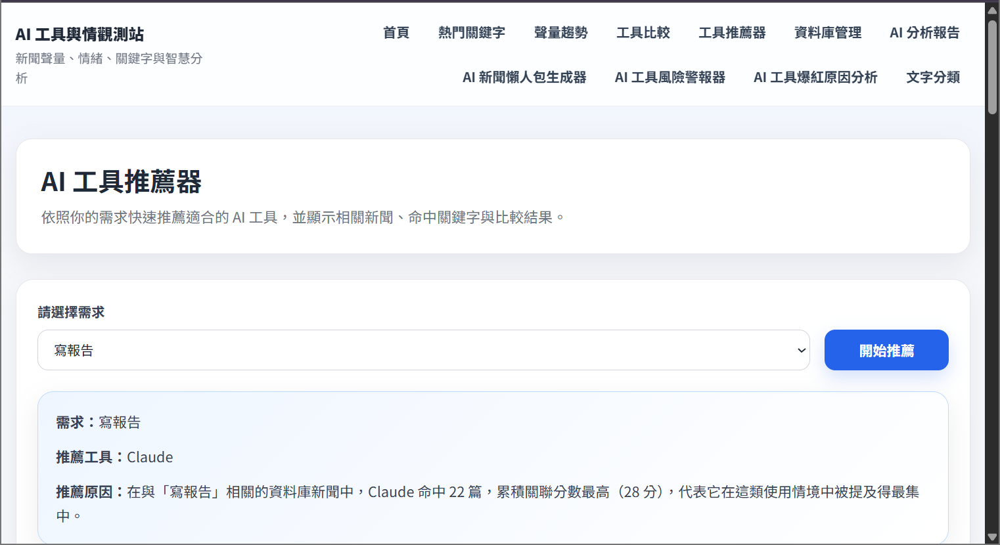

| 項目 | 說明 |
|---|---|
| 頁面功能 | 依使用者選擇的任務類型，例如報告、查資料、程式、翻譯、摘要，使用任務關鍵字比對新聞內容，推薦較相關的 AI 工具並列出代表新聞。 |
| 使用者操作流程 | 選擇任務 -> 系統計算各工具命中分數與文章數 -> 顯示推薦工具、排名、相關字與代表新聞。 |
| 使用到的技術 | Django GET form、關鍵字比對、Counter 排名。 |
| 是否使用資料庫 | 有，讀取 NewsArticle。 |
| 是否使用 AI 模型或關鍵字判斷 | 沒有呼叫 AI；推薦邏輯是關鍵字規則與資料庫新聞命中分數。 |

### DB 新聞查詢 (/news-db/)

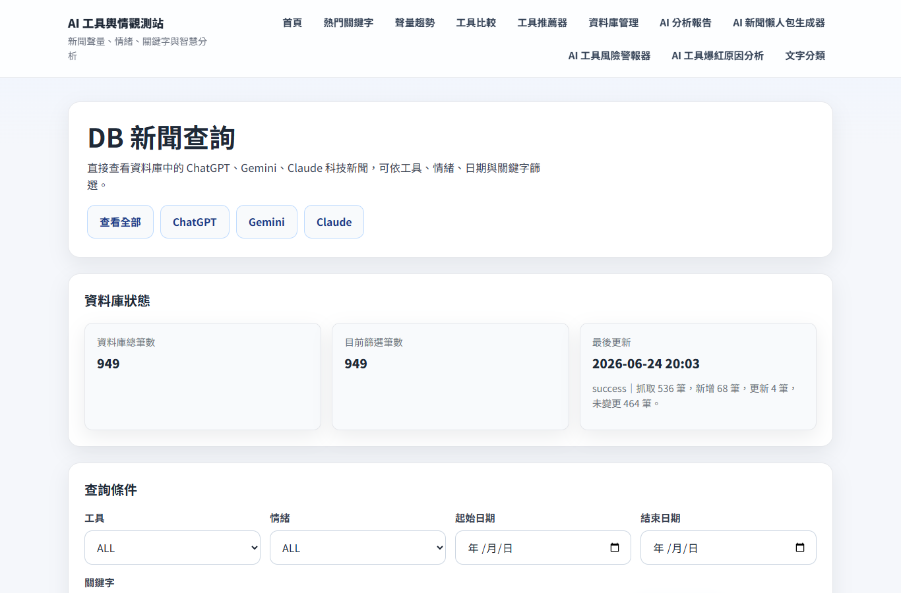

| 項目 | 說明 |
|---|---|
| 頁面功能 | 提供新聞資料庫查詢介面，可依工具、情緒、關鍵字、日期區間篩選，並以分頁顯示新聞清單與原文連結。 |
| 使用者操作流程 | 設定篩選條件 -> 送出查詢 -> 查看資料庫狀態與新聞列表 -> 換頁或開啟原文。 |
| 使用到的技術 | Django Paginator、Q object 關鍵字搜尋、SQLite indexes。 |
| 是否使用資料庫 | 有，讀取 NewsArticle 與 DataUpdateLog。 |
| 是否使用 AI 模型或關鍵字判斷 | 沒有即時呼叫 AI；資料欄位中的 tool/sentiment/keywords 由更新流程的規則產生。 |

### AI 自動生成分析報告 (/ai-report/)

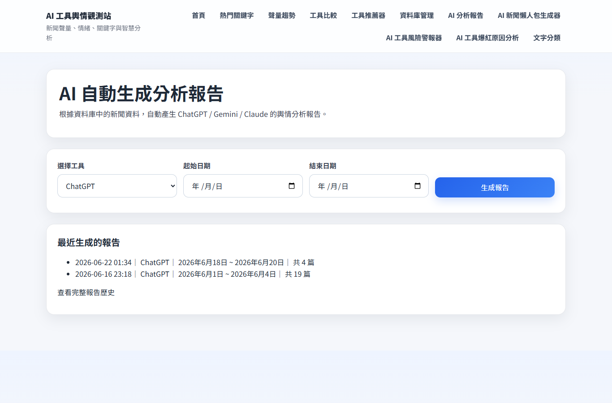

| 項目 | 說明 |
|---|---|
| 頁面功能 | 使用者選擇工具與日期區間後，系統統計聲量、情緒、熱門關鍵字與代表新聞，再交給 Ollama 生成較完整的分析報告，並保存歷史紀錄。 |
| 使用者操作流程 | 選工具與日期 -> 送出 -> 統計資料 -> 呼叫 Ollama -> 顯示報告 -> 存入 AnalysisReport。 |
| 使用到的技術 | Django POST、ORM aggregation、Ollama API、fallback_digest、SQLite 保存報告。 |
| 是否使用資料庫 | 有，讀取 NewsArticle，寫入 AnalysisReport。 |
| 是否使用 AI 模型或關鍵字判斷 | 有，呼叫 Ollama `gemma3:4b`；失敗時改用 fallback 報告。 |

### 報告歷史 (/ai-report/history/)

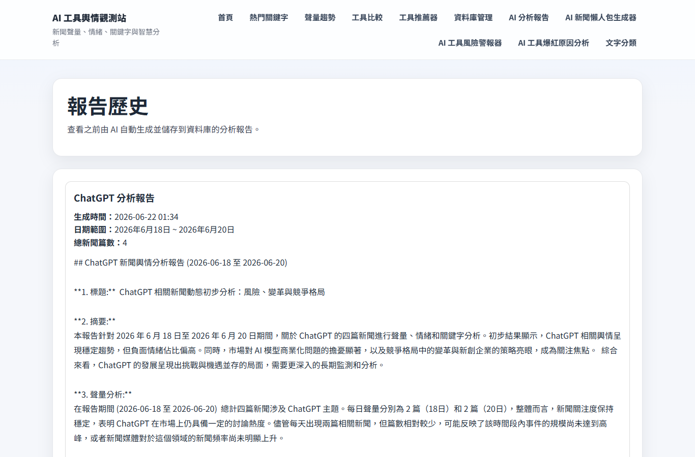

| 項目 | 說明 |
|---|---|
| 頁面功能 | 列出過去由 AI 自動生成的分析報告，方便追蹤不同時間與工具的分析結果。 |
| 使用者操作流程 | 進入歷史頁 -> 依建立時間查看報告摘要。 |
| 使用到的技術 | Django template、AnalysisReport ordering。 |
| 是否使用資料庫 | 有，讀取 AnalysisReport。 |
| 是否使用 AI 模型或關鍵字判斷 | 沒有即時呼叫 AI；顯示過去生成結果。 |

### AI 新聞懶人包生成器 (/ai-digest/)

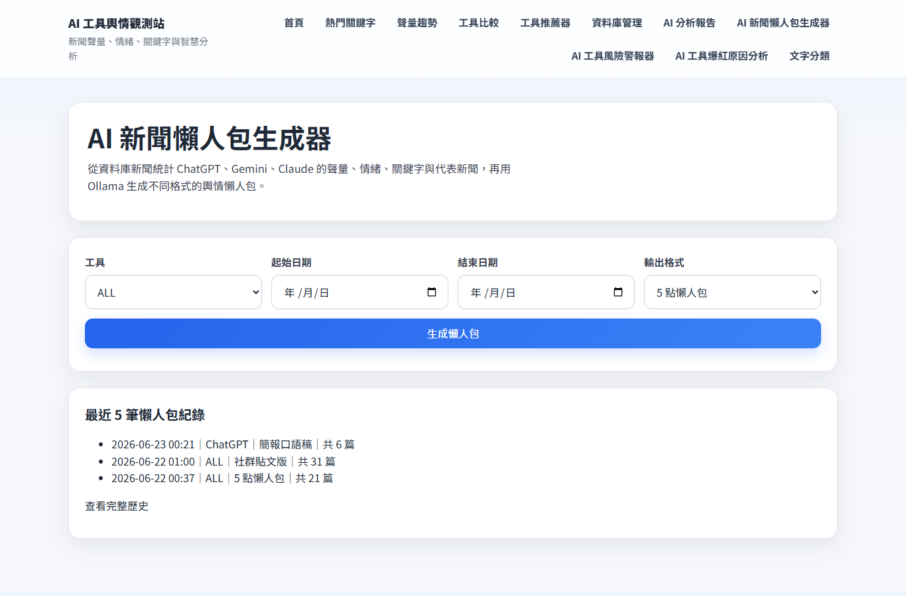

| 項目 | 說明 |
|---|---|
| 頁面功能 | 依工具、日期與輸出形式，將新聞統計與代表新聞交給 Ollama 生成懶人包，可選 5 點懶人包、專業分析、簡報口語稿、學生版、社群貼文版等格式。 |
| 使用者操作流程 | 選工具/日期/格式 -> 送出 -> 統計新聞 -> 呼叫 Ollama -> 顯示懶人包與代表新聞 -> 存入 DigestReport。 |
| 使用到的技術 | Django POST、Ollama API、collect_keyword_counts、fallback_digest。 |
| 是否使用資料庫 | 有，讀取 NewsArticle，寫入 DigestReport。 |
| 是否使用 AI 模型或關鍵字判斷 | 有，呼叫 Ollama `gemma3:4b`；失敗時改用 fallback 懶人包。 |

### 懶人包歷史紀錄 (/ai-digest/history/)

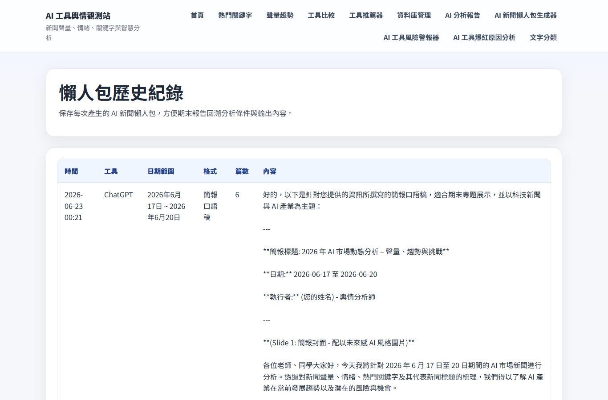

| 項目 | 說明 |
|---|---|
| 頁面功能 | 顯示過去產生的懶人包紀錄、工具、日期區間、格式、新聞筆數與內容。 |
| 使用者操作流程 | 進入歷史頁 -> 查看歷史懶人包。 |
| 使用到的技術 | Django template、DigestReport ordering。 |
| 是否使用資料庫 | 有，讀取 DigestReport。 |
| 是否使用 AI 模型或關鍵字判斷 | 沒有即時呼叫 AI；顯示過去生成結果。 |

### AI 工具風險警報器 (/risk-alert/)

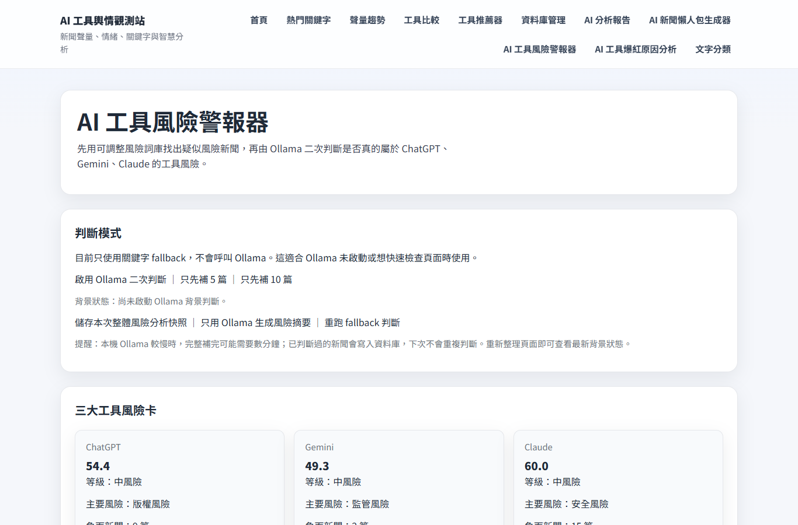

| 項目 | 說明 |
|---|---|
| 頁面功能 | 對 ChatGPT、Gemini、Claude 新聞進行風險偵測，先用風險詞找候選新聞，再可啟動 Ollama 二次判斷，最後產生風險分數、風險等級、主要風險類型、風險新聞列表與摘要。 |
| 使用者操作流程 | 進入頁面 -> 查看 fallback 風險結果 -> 可點選啟用 Ollama 二次判斷/補判斷/重跑 fallback/保存快照 -> 查看圖表與代表風險新聞。 |
| 使用到的技術 | 風險詞表、Django ORM cache、背景 thread、Chart.js、Ollama JSON prompt、fallback_risk_summary。 |
| 是否使用資料庫 | 有，讀取 NewsArticle，讀寫 RiskArticleJudgement 與 RiskAnalysisResult。 |
| 是否使用 AI 模型或關鍵字判斷 | 有，Ollama 對候選新聞做 JSON 二次判斷，也可生成風險摘要；失敗時保留關鍵字 fallback。 |

### AI 工具爆紅原因分析 (/hot-event/)

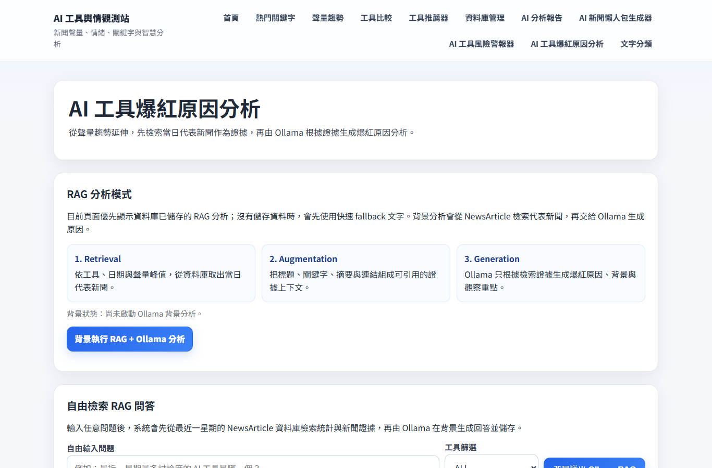

| 項目 | 說明 |
|---|---|
| 頁面功能 | 偵測每日聲量暴增或峰值事件，整理熱門關鍵字與代表新聞，並支援 RAG 問答或背景執行 Ollama 分析爆紅原因。 |
| 使用者操作流程 | 進入頁面 -> 查看 RAG 模式與預設問題 -> 可送出自由問題或背景分析 -> 查看爆紅事件總覽、折線圖、事件列表與證據新聞。 |
| 使用到的技術 | 每日聲量統計、峰值/倍增規則、RAG context retrieval、背景 thread、Chart.js、Ollama prompt。 |
| 是否使用資料庫 | 有，讀取 NewsArticle，讀寫 HotEvent 與 HotEventRAGQuery。 |
| 是否使用 AI 模型或關鍵字判斷 | 有，Ollama 生成 RAG 回答與爆紅原因；失敗時 fallback 成基於關鍵字與代表新聞的原因說明。 |

### 資料庫管理後台 (/admin/)

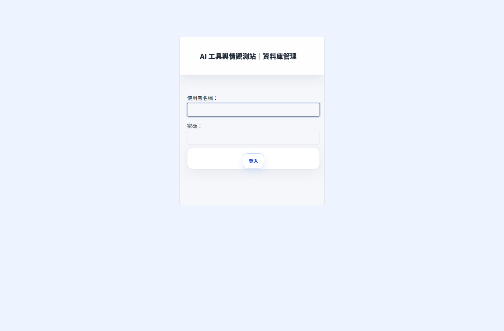

| 項目 | 說明 |
|---|---|
| 頁面功能 | Django Admin 後台，提供模型資料管理入口。專案自訂 admin base_site 與 custom_admin.css，讓後台風格與前台一致。 |
| 使用者操作流程 | 進入 /admin/ -> 登入管理員帳號 -> 管理 NewsArticle、DataUpdateLog、AnalysisReport、DigestReport、RiskAnalysisResult、RiskArticleJudgement、HotEvent、HotEventRAGQuery。 |
| 使用到的技術 | Django Admin、ModelAdmin、custom_admin.css。 |
| 是否使用資料庫 | 有，管理已註冊模型資料。 |
| 是否使用 AI 模型或關鍵字判斷 | 沒有即時呼叫 AI；管理 AI 生成或判斷後保存的資料。 |

    ## 4. AI 模型與風險警報器說明

    ### Ollama 使用位置

    | 功能 | 使用方式 |
    |---|---|
    | AI 自動生成分析報告 | 統計日期聲量、情緒、關鍵字與代表新聞後，組成 prompt 交給 Ollama 生成分析報告 |
    | AI 新聞懶人包 | 依工具、日期、輸出格式，將統計摘要與代表新聞交給 Ollama 生成不同風格的懶人包 |
    | 風險警報器 | 對風險詞命中的候選新聞進行二次 JSON 判斷，確認是否真的是該工具相關風險 |
    | 風險摘要 | 可要求 Ollama 根據風險統計資料生成整體風險解讀 |
    | 爆紅原因分析 | 使用 RAG 取回代表新聞，再由 Ollama 解釋爆紅原因或回答使用者問題 |

    ### 模型名稱

    專案在 `app_news_db/utils.py` 中設定：

    - `OLLAMA_URL = "http://localhost:11434/api/generate"`
    - `OLLAMA_MODEL = "gemma3:4b"`

    ### Prompt 設計方式

    專案中的 prompt 不是單純要求摘要，而是會先整理結構化資料，再要求模型用繁體中文輸出。常見輸入包含：

    - 工具名稱與日期區間。
    - 新聞總筆數。
    - 每日聲量。
    - 情緒分布。
    - 熱門關鍵字 Top N。
    - 代表新聞標題與內容片段。
    - RAG 檢索出的新聞證據。
    - 風險判斷時要求模型只輸出 JSON，欄位包含 `is_risk`、`risk_type`、`reason`。

    ### 風險判斷邏輯

    風險警報器的流程如下：

    1. 只分析 ChatGPT、Gemini、Claude 三個工具，不把 Other 當成工具風險。
    2. 對每篇新聞的標題與前段內容進行風險詞命中檢查。
    3. 若沒有命中風險詞，該新聞不進入風險候選。
    4. 若命中風險詞，系統可呼叫 Ollama 進行二次判斷。
    5. Ollama prompt 會要求確認新聞是否真的和該工具風險有關，避免只是順便提到工具。
    6. Ollama 回傳 JSON 後，系統解析 `is_risk`、`risk_type`、`reason`。
    7. 若判定為風險，納入代表風險新聞與風險類別統計。
    8. 風險分數公式為：`risk_article_rate * 60 + negative_rate * 40`，最高 100。
    9. 風險等級：小於等於 30 為低風險，小於等於 60 為中風險，超過 60 為高風險。

    ### 關鍵字判斷邏輯

    專案中的關鍵字與規則判斷分成幾種：

    - 工具分類：依標題與內容中 ChatGPT/OpenAI、Gemini、Claude/Anthropic 等詞的出現位置與次數計分。
    - 情緒分類：依正面詞與負面詞在標題、內容中的命中分數決定正面、中性、負面。
    - 關鍵字抽取：使用英文/中文 token 正規表示式與停用詞過濾，再取最高頻詞。
    - 風險候選：依 `RISK_WORDS_BY_TYPE` 中的隱私、版權、安全、監管、公司營運、技術風險等詞表命中。
    - 推薦器：依任務類型的關鍵字命中新聞內容與 keywords 欄位，計算每個工具的分數。

    ### Fallback 機制

    專案有明確 fallback 設計：

    - `fallback_digest()`：Ollama 報告或懶人包失敗時，改用新聞筆數、熱門關鍵字與代表標題產生簡易文字。
    - `fallback_risk_summary()`：Ollama 風險摘要失敗時，使用最高風險分數工具產生簡要說明。
    - `_fallback_judgement()`：Ollama 無法完成單篇風險判斷時，先以風險詞命中結果作為 fallback。
    - `fallback_hot_event()`：Ollama 爆紅原因分析失敗時，使用熱門關鍵字與代表新聞產生原因說明。
    - 背景判斷與背景 RAG 分析都有 job state，用來避免長時間請求阻塞頁面。

    ## 5. 使用流程

    1. 使用者進入首頁，查看新聞資料庫總量、各工具新聞量與更新狀態。
    2. 若想查資料，進入 DB 新聞查詢頁，用工具、情緒、關鍵字或日期篩選新聞。
    3. 若想看討論焦點，進入熱門關鍵字頁，選擇工具與 Top N 數量查看文字雲與表格。
    4. 若想看時間變化，進入聲量趨勢頁，查看每日折線圖，並點擊日期查看新聞明細。
    5. 若想比較工具，進入工具比較頁，查看新聞量、情緒比例與熱門字差異。
    6. 若想依任務挑工具，進入工具推薦器，選擇任務後查看推薦工具與代表新聞。
    7. 若想產生文字報告，進入 AI 分析報告頁，選擇工具與日期區間後產生並保存報告。
    8. 若想產生短版摘要，進入 AI 新聞懶人包生成器，選擇輸出格式後產生懶人包。
    9. 若想觀察風險，進入 AI 工具風險警報器，查看風險卡、風險分數、風險類別與代表新聞；必要時啟用 Ollama 二次判斷。
    10. 若想知道某工具為何爆紅，進入 AI 工具爆紅原因分析，查看事件列表、折線圖，或提交 RAG 問題產生答案。
    11. 管理者可進入 Django Admin 管理新聞、報告、懶人包、風險判斷與爆紅事件資料。

    ## 6. 結論與未來改進

    ### 目前完成的功能

    - 新聞資料庫與 TechNews AI 新聞更新流程。
    - 工具分類、情緒分類、關鍵字抽取與資料庫查詢。
    - 熱門關鍵字、聲量趨勢、工具比較等視覺化頁面。
    - AI 報告與新聞懶人包生成功能，並保存歷史紀錄。
    - 風險警報器，包含關鍵字候選、Ollama 二次判斷、風險分數與 fallback。
    - 爆紅事件偵測與 RAG/Ollama 原因分析。
    - Django Admin 後台管理與自訂後台樣式。

    ### 目前限制

    - 工具分類、情緒分類與關鍵字抽取主要是規則式方法，準確度取決於詞表與新聞文字品質。
    - Ollama 需要本機服務可用，若模型未啟動或逾時，只能使用 fallback。
    - SQLite 適合課堂專題與小型系統，但大量背景寫入時可能遇到 DB lock，因此程式中也特別關閉啟動時自動大量更新。
    - 新聞來源目前主要是 TechNews AI 分類頁，來源多樣性有限。
    - 前端圖表使用 CDN 載入 Chart.js / WordCloud2.js，離線環境可能無法正常顯示圖表。
    - 登入帳號、角色權限、留言資料與社群平台資料尚未在專案中明確定義。

    ### 未來可以加入的功能

    - 使用更準確的 NLP 或 LLM 分類器改善工具分類、情緒分析與風險判斷。
    - 增加更多新聞來源，例如國內外科技媒體、官方部落格、社群平台。
    - 加入留言或社群討論分析，擴大輿情資料來源。
    - 增加更多圖表視覺化，例如風險趨勢、情緒趨勢、關鍵字共現網路。
    - 建立帳號系統與權限控管，區分一般使用者與管理者。
    - 增加匯出功能，例如匯出 CSV、PDF、簡報。
    - 將背景工作改為 Celery / RQ，提升長時間 Ollama 分析與爬蟲任務的穩定性。
    - 將 SQLite 升級為 PostgreSQL，以支援更大量資料與多人使用情境。
